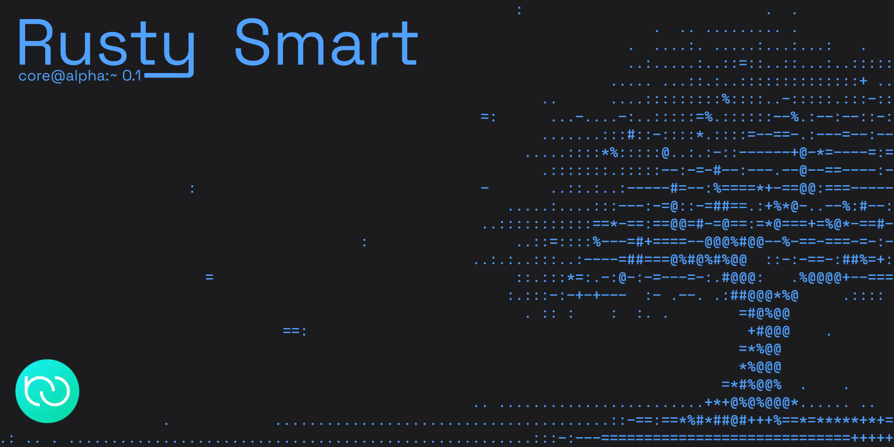

# 🧠 Rusty Smart Module

**Dynamically create & delete servers, with ANY provider, and the magic of RustyConnector!**

[📖 Documentation](https://smart.democraft.fr/docs/smart/) · [☁️ Providers](https://smart.democraft.fr/docs/providers/) · [💬 Support](https://dsc.gg/drmcld)

---

## 📌 Overview

RC Smart brings **horizontal scaling** to *any* Minecraft network.
Cut costs and give your players better performance by only hosting the servers they actually play on.

Smart also uses an **abstract technology layer**, so it can be integrated with virtually **any cloud provider**.

## ✨ Features

Smart aims to be a flexible, modular cloud system. Like any cloud system, it brings three key features:

| Feature | Description |
| --- | --- |
| ⚖️ **Load Balancing** | Per server group ("family"), handled by *RustyConnector* |
| 🧩 **Dynamic Server Creation** | Creates servers when they're needed |
| 🧹 **Smart Cleanup** | Deletes servers when they're not in use |

## 🧱 Installation

1. Drop the module's `.jar` file into the `rc-modules` folder of your Minecraft proxy.
2. Restart the RustyConnector kernel.
3. Let the magic happen ✨

> 💡 For detailed setup instructions, see the [official documentation](https://smart.democraft.fr/docs/smart/).

## ☁️ Providers

Smart needs **at least one** [provider](https://smart.democraft.fr/docs/providers/) to work.
A provider acts as an adapter between Smart and your infrastructure.

| Provider | Description |
| --- | --- |
| 🦖 [**Pterodactyl**](https://modrinth.com/plugin/rcs-pterodactyl) | Uses the Pterodactyl Panel API to dynamically scale your Minecraft network |

## 💬 Need help?

- 📖 Read the [documentation](https://smart.democraft.fr/docs/smart/)
- 💬 Contact [Smart's Support](https://dsc.gg/drmcld) on Discord
